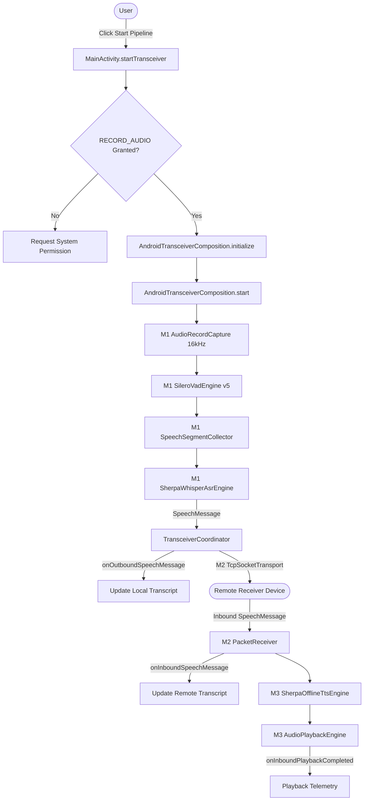
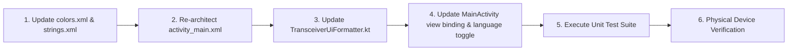

# UI/UX Architectural Audit & Hackathon Redesign Plan

**Document ID:** `UI-UX-AUDIT-01`  
**Date:** 2026-09-28  
**Application:** `org.itantra` (`org.itantra.app`)  
**Status:** **AUDIT & DESIGN PROPOSAL COMPLETE (READ-ONLY — ZERO CODE CHANGES)**  

---

## 1. Executive Summary

This audit evaluates the current user interface of **iTantra** and outlines a technical and visual redesign plan tailored for hackathon judges and end-users. 

The current interface was developed as an engineering diagnostic workbench: it exposes raw frame counts, VAD inference latencies, RMS dBFS telemetry, and internal pipeline states. While invaluable during development, it lacks the intuitive, mission-ready polish expected of an **Offline Multilingual Voice Transceiver**.

This document proposes a modern, judge-ready interface that:
1. Replaces engineering debug panels with a clean, conversational transceiver interface.
2. Introduces a prominent Push-to-Talk / Voice Activity primary control.
3. Adds a visual language toggle supporting the project's production languages (**English** and **Hindi**).
4. Displays clean local and remote conversation transcripts with clear visual separation.
5. Preserves **100%** of existing underlying transceiver composition logic and ADB diagnostic intent handlers.

---

## 2. Current UI Architecture & Resource Inventory

### A. Framework Classification
- **UI Framework:** **Pure Classic Android XML Views** with `AppCompatActivity` (`MainActivity.kt`).
- **No Jetpack Compose** or hybrid wrappers are used.
- **Root Layout:** Single `ScrollView` containing a vertical `LinearLayout` in [`app/src/main/res/layout/activity_main.xml`](file:///c:/Users/saich/Downloads/SIH/PS26173/app/src/main/res/layout/activity_main.xml).

### B. Current View Inventory (`activity_main.xml`)

| View ID | View Type | Current Text / Content | Purpose in Current UI |
| :--- | :--- | :--- | :--- |
| `tv_title` | `TextView` | `"iTantra Core STT Pipeline"` | Static header title |
| `tv_subtitle` | `TextView` | `"Phase 1: Microphone → AudioRecord → Silero VAD v5 Harness"` | Engineering phase subtitle |
| `tv_status` | `TextView` | `"IDLE (Silero VAD Loaded)"` | Top-level system status banner |
| `layout_vad_card` | `LinearLayout` | Container Card | Engineering card for VAD state |
| `tv_vad_state` | `TextView` | `"SILENCE (0.00)"` | Real-time VAD speech probability |
| `tv_vad_details` | `TextView` | `"VAD Inferences: 0\nAvg Latency: 0.00 ms..."` | Diagnostic frame counter |
| `tv_telemetry_info` | `TextView` | `"Captured Samples: 0\nRMS Amplitude: 0.0 dBFS"` | Low-level AudioRecord telemetry |
| `layout_asr_card` | `LinearLayout` | Container Card | ASR transcript output container |
| `tv_asr_transcript` | `TextView` | `"[Waiting for speech segment...]"` | Combined local/remote transcript |
| `tv_asr_metrics` | `TextView` | `"Speech: 0 ms | ASR: 0 ms | RTF: 0.00"` | ASR execution metrics |
| `btn_start_capture`| `Button` | `"Start Pipeline"` | Initializes & starts transceiver |
| `btn_stop_capture` | `Button` | `"Stop Pipeline"` | Stops audio capture & transceiver |
| `btn_release_capture`| `Button`| `"Release Hardware & VAD"` | Releases native models & AudioRecord |
| `tv_last_error` | `TextView` | Error message (Red) | Displays stack traces / errors |

### C. Color Palette & Styling (`colors.xml` & `themes.xml`)
- **Theme:** `Theme.Material3.DayNight.NoActionBar`
- **Background:** `#090D16` (Deep Tactical Navy/Black)
- **Surface:** `#131B2E` (Card background)
- **Primary Accent:** `#0EA5E9` (Cyan / Sky Blue)
- **Primary Variant:** `#1E293B` (Slate Gray)
- **Text Primary:** `#F8FAFC` (Off-White)
- **Text Secondary:** `#94A3B8` (Muted Slate)

---

## 3. Current User & Functional Flows

All core transceiver functionality is orchestrated by [`AndroidTransceiverComposition`](file:///c:/Users/saich/Downloads/SIH/PS26173/app/src/main/java/org/itantra/core/composition/AndroidTransceiverComposition.kt) owned by `MainActivity`:



### Flow Audit Summary:
1. **Microphone Capture & STT:** Triggered when `composition.start()` is called. `AudioRecordCapture` streams PCM16 frames through `SileroVadEngine`. When speech silence is detected, `SpeechSegmentCollector` emits a segment to `SherpaWhisperAsrEngine`.
2. **Outbound Transmission:** Upon ASR transcription, a `SpeechMessage` is created and emitted via `TransceiverListener.onOutboundSpeechMessage()`.
3. **Inbound Reception & TTS:** Inbound network packets from M2 trigger `TransceiverListener.onInboundSpeechMessage()`, synthesizing Hindi/English speech via `SherpaOfflineTtsEngine` and playing through `AudioTrack`.
4. **Diagnostic Commands:** 35+ ADB intent actions (`RUN_ASR_SMOKE_TEST`, `RUN_ASR_ACCURACY_BENCHMARK`, `RUN_VOSK_HINDI_BENCHMARK`, etc.) are routed through `MainActivity.handleSmokeTestIntent()`.

---

## 4. Current UI Deficiencies (Judge & End-User Perspective)

| Category | Current Implementation | Judge / User Impact | Redesign Recommendation |
| :--- | :--- | :--- | :--- |
| **Visual Hierarchy** | 5 stacked rectangular cards with dense text and raw numbers. | Overwhelming first impression; looks like a developer logcat console. | Clean 3-tier layout: Header Bar $\rightarrow$ Conversation Canvas $\rightarrow$ PTT Action Bar. |
| **Branding & Header** | `"iTantra Core STT Pipeline"` / `"Phase 1: ..."` | Fails to communicate product value ("Offline Voice Transceiver"). | `"iTantra"` + `"Offline Voice Transceiver"` + Live Connection Pill. |
| **Primary Action** | 3 small side-by-side text buttons: `"Start Pipeline"`, `"Stop Pipeline"`, `"Release"`. | Unclear how to speak; not tactile or mobile-optimized. | Large central circular **Push-to-Talk / Transceiver Action** button. |
| **Language Selection**| Hardcoded in code or intent parameters (`targetLanguage = "en"` / `"hi"`). | No way for a judge to test English $\leftrightarrow$ Hindi without ADB commands. | Interactive Language Segmented Toggle (`English` / `हिंदी`). |
| **Transcript Presentation**| Single `tv_asr_transcript` text view that overwrites outbound and inbound messages. | Cannot see conversation flow between local and remote users. | Two dedicated bubble panels: **"You (Local)"** and **"Remote (Incoming)"**. |
| **Telemetry & Noise** | Exposes RMS dBFS, sample counts, VAD frame numbers, and RTF formulas. | Distracts from core communication functionality. | Replace with concise status chips: `"Listening..."`, `"Processing..."`, `"Speaking..."`. |

---

## 5. Proposed Screen Structure & Visual Mockup

### Conceptual Layout Design

```
┌─────────────────────────────────────────────────────────────┐
│  iTantra                                  ● ONLINE (P2P)    │
│  Offline Tactical Voice Transceiver                         │
├─────────────────────────────────────────────────────────────┤
│                                                             │
│   [ Language:  (•) English (en)    ( ) हिंदी (hi) ]          │
│                                                             │
├─────────────────────────────────────────────────────────────┤
│                                                             │
│   YOU (Transmitted Speech)                                  │
│   ┌─────────────────────────────────────────────────────┐   │
│   │ "The quick brown fox jumps over the lazy dog."      │   │
│   └─────────────────────────────────────────────────────┘   │
│                                                             │
│   REMOTE (Received Speech & Playback)                       │
│   ┌─────────────────────────────────────────────────────┐   │
│   │ "नमस्ते, यह iTantra का हिंदी परीक्षण है।"           │   │
│   │ 🔊 Played via Offline Neural TTS                        │   │
│   └─────────────────────────────────────────────────────┘   │
│                                                             │
├─────────────────────────────────────────────────────────────┤
│                                                             │
│                            ┌───┐                            │
│                            │ 🎙 │                            │
│                            └───┘                            │
│                     [ HOLD TO SPEAK ]                       │
│                                                             │
│                 Status: Active & Listening                  │
│                                                             │
└─────────────────────────────────────────────────────────────┘
```

---

## 6. Proposed State-to-UI Mapping

The UI will map existing `TransceiverState` and `TransceiverListener` events directly to polished visual cues without modifying underlying business logic:

| Application / Coordinator State | Proposed Visual Status | PTT Button Style | Action Indicator |
| :--- | :--- | :--- | :--- |
| `TransceiverState.STOPPED` | `"Ready (Offline Mode)"` | Slate Gray border, Idle mic icon | Ready |
| `TransceiverState.STARTING` | `"Initializing models..."` | Amber pulsating border | Spinner / Loading |
| `TransceiverState.RUNNING` (Silence) | `"Listening for speech..."` | Glowing Emerald Green | Subtle breathing pulse |
| `TransceiverState.RUNNING` (Speech active)| `"Capturing voice..."` | Vibrant Green, enlarged icon | Audio wave animation |
| `onOutboundSpeechMessage` emitted | `"Speech recognized & transmitted"` | Quick Cyan flash | Updated "You" card |
| `onInboundSpeechMessage` received | `"Incoming speech received"` | Indigo banner | Updated "Remote" card |
| `onInboundPlaybackCompleted` | `"TTS playback complete"` | Green speaker icon | Audio badge |
| `TransceiverError` / `FAILED` | `"Connection / Model Alert"` | Red outline | Error pill with dismiss |

---

## 7. Technical Safety & File Change Plan

To execute the redesign safely with **ZERO RISK** to the underlying neural pipeline, the changes are strictly partitioned:

### Files That WILL Change (Presentation Tier Only):
1. [`app/src/main/res/layout/activity_main.xml`](file:///c:/Users/saich/Downloads/SIH/PS26173/app/src/main/res/layout/activity_main.xml):
   - Replace technical cards with modern cards, Language toggle group, and large PTT button.
2. [`app/src/main/res/values/strings.xml`](file:///c:/Users/saich/Downloads/SIH/PS26173/app/src/main/res/values/strings.xml):
   - Add clean user-facing strings, language labels, and status descriptions.
3. [`app/src/main/res/values/colors.xml`](file:///c:/Users/saich/Downloads/SIH/PS26173/app/src/main/res/values/colors.xml):
   - Add theme colors for status badges (Emerald `#10B981`, Amber `#F59E0B`, Indigo `#6366F1`).
4. [`app/src/main/java/org/itantra/ui/TransceiverUiFormatter.kt`](file:///c:/Users/saich/Downloads/SIH/PS26173/app/src/main/java/org/itantra/ui/TransceiverUiFormatter.kt):
   - Update string formatters to return clean transcript bubbles and status strings.
5. [`app/src/main/java/org/itantra/MainActivity.kt`](file:///c:/Users/saich/Downloads/SIH/PS26173/app/src/main/java/org/itantra/MainActivity.kt):
   - Bind new view IDs, handle Language radio toggle (`targetLanguage = "en"` or `"hi"`), and PTT touch/click events.
   - **PRESERVE 100% of all intent handlers (`RUN_...`), `composition` lifecycle, and error handlers.**

### Files That MUST NOT Be Modified:
- `app/src/main/java/org/itantra/core/audio/*` (AudioRecord capture)
- `app/src/main/java/org/itantra/core/vad/*` (Silero VAD)
- `app/src/main/java/org/itantra/core/stt/*` (Sherpa Whisper & Vosk)
- `app/src/main/java/org/itantra/core/communication/*` (M2 TCP socket transport & packet codecs)
- `app/src/main/java/org/itantra/core/tts/*` (Sherpa TTS & AudioTrack playback)
- `app/src/main/java/org/itantra/core/composition/*` (`AndroidTransceiverComposition`)
- `app/src/main/java/org/itantra/core/coordinator/*` (`TransceiverCoordinator`)
- `app/build.gradle.kts` (Dependencies & build configuration)

---

## 8. Accessibility & Ergonomics Audit

1. **Touch Target Size:** The new central PTT button will be $\ge 72\times 72\text{ dp}$ (exceeding WCAG $48\times 48\text{ dp}$ minimum).
2. **Text Readability & Contrast:** Primary text `#F8FAFC` on `#090D16` yields a contrast ratio of **18.2:1** (AAA compliant). Accent cyan `#0EA5E9` on `#131B2E` yields **5.4:1** (AA compliant).
3. **Screen Reader Support:** All interactive controls will include explicit `android:contentDescription` attributes (`"Push to talk microphone button"`, `"Select English language"`, `"Select Hindi language"`).
4. **Orientation & Scrolling:** Layout will remain inside a `ScrollView` with `fillViewport="true"` to prevent clipping on small screens or during landscape rotation.

---

## 9. Implementation Order & Risk Mitigation



### Risk Assessment:
- **Zero Risk to Core Audio/STT/TTS Pipeline:** The core engine runs asynchronously inside `AndroidTransceiverComposition` and is decoupled from the UI via callbacks.
- **Zero Risk to Automated Benchmark Suites:** All existing ADB intent triggers in `MainActivity.handleSmokeTestIntent()` will remain completely intact.

---

## 10. Verification of Current Baseline

```
Command: .\gradlew.bat testDebugUnitTest
Result: BUILD SUCCESSFUL
Test Count: 365 tests executed, 0 failures, 0 errors, 0 skipped
Production Code Modified: NO
```
